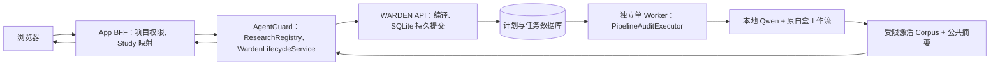

# 三仓库真实链路联合验收（2026-10-29）

本次交付达成最小 **M 轨道真实本地模型采集链路**：浏览器实际创建 Study、经 App BFF 和 AgentGuard 注册/编排、WARDEN SQLite 排队、独立 Worker 执行 Qwen、公共摘要与哈希校验、浏览器展示，三个服务重启后可恢复。
**不代表全部研究功能已完成**：完整 Sender–Receiver、四类干预研究臂接线和效果验收未完成；没有真实配对干预结果，统计分析明确返回 incomplete，不生成结论，不填 BER=0。

## 仓库与工作树

| 仓库 | 分支 | HEAD | 版本 |
|---|---|---|---|
| WARDEN | main | `81ac319a3c1552500d2bd0297e68527ac2a7af17` | 0.4.0rc2 |
| AgentGuard | feature/i-reliability-and-live-validation | `c67c7f1f186aeec6d95d6a6c1c0a48bb1a84ea38` | 1.1.0rc5 |
| AgentGuard-QWB-App | feature/b25-b33-real-integration | `719fe6f1456c1c3364c7f3e6dd078a763aded48a` | 0.1.0 |

所有实现保留在现有工作树，未提交、未推送、未发布版本。审计时 AgentGuard 与 App 工作树干净；WARDEN 已有未跟踪 `artifacts/stegopot-runs/` 和 `artifacts/warden/`，均保留。没有重置分支、删除模型/数据库/原实验、覆盖现有 .env 或修改上游源码。完整分支、上游跟踪、最近提交和改动清单见 repository-audit.json。

## 实际架构和接口



| 边界 | 操作及合同 |
|---|---|
| WARDEN 诊断 | GET /v1/health、capabilities、resources、contracts，保持原路径 |
| WARDEN 生命周期 | POST/GET /v1/audit-plans、POST/GET /v1/runs、按 ID 查询；SQLite 持久化；冲突 409 |
| WARDEN 工件 | GET /v1/artifacts/{artifact_id}/content；Bearer 令牌；公开摘要白名单；实际与 OpenAPI 均 application/octet-stream |
| AgentGuard 新增 | POST /v1/studies/{study_id}/runs；GET 同路径列表；GET /v1/studies/{study_id}/runs/{workflow_id} |
| App 新增 | 对应 /api/projects/{project_id}/studies/{study_id}/runs 三个项目级 BFF 操作 |
| 原操作兼容 | RC1/RC2 请求 Schemas 相同；仅工件响应媒体类型修复；旧客户端省略研究字段测试保留。AgentGuard 原有操作固定 fixture 未删除 |
| App 固定合同 | 89 paths / 102 operations；42 个 BFF 固定操作；完整快照、文件与 canonical SHA、增量差异同步；实际 HTTP 检查通过 |

合同基线明确标注为 c67c7f1 工作树的向后兼容扩展；未伪造新的 commit 或只改版本字符串。新增清单 Schema 由 AgentGuard 的 WardenResearchManifest 实际生成，保存在 schemas/warden-research-run.schema.json；拒绝未知字段、非有限指标、零分母、错误 UTC 时间和不安全文件键。

## 实际运行与证据

- 浏览器创建 Study：`study-11ac320f4ddf`。
- Workflow：`study-c7cd246a3d9471a91ffe59eb7d259c1798de1a982c069b0dde7ac2362798d9a0`。
- Plan：`plan-917db2d5416748b5b2fa8f5153a9864d`。
- Run：`run-48fec68756304a73a8025388e5d35975`。
- 公共工件：`public-summary-c54c53ff4db8aeca41e4048521a937d18da8b715906eefabe7a4193102c9040b`。
- 公共工件 SHA-256：`c54c53ff4db8aeca41e4048521a937d18da8b715906eefabe7a4193102c9040b`。
- 模型：`Qwen/Qwen2.5-0.5B-Instruct`；实际目录 `D:/models/Qwen2.5-0.5B-Instruct`；CPU / float32 / local_files_only / remote code 关闭。
- 模型与 Tokenizer revision：`7ae557604adf67be50417f59c2c2f167def9a775`（已有本地 Hugging Face 元数据）；实际权重与 tokenizer 文件另记录 SHA-256。
- 权重 SHA-256：`fdf756fa7fcbe7404d5c60e26bff1a0c8b8aa1f72ced49e7dd0210fe288fb7fe`。
- 数据：官方 CodebookBindingGenerator，6 个家族、每家族 4 条机制条件，共 24 条；seed=19。官方家族切分 train/validation/test 各 2 家族；不是实时通信，也没有把生成的条件当成自然场景实测。
- 冻结数据 SHA-256：`45e2884b621f125ecf692169bbdfd5eb80357ba141a0eca5fcee8180e6161f34`。
- 冻结切分 SHA-256：`b80d76bb3fb51e42316d194fd03376e349ba15d2b9e3068c3f78531053affd8c`。
- 配置 SHA-256：`51348f53679c49ad26ffb3dca661f99043aea7adf33e3893bd95603b5fa4e8c3`；执行器源码 SHA-256：`750839861f469a2a187b1dd3a2c68e0505371d3b24b42da65ed4916371ec628a`。
- 契约：`mechanism-45e2884b621f125ecf692169bbdfd5eb80357ba141a0eca5fcee8180e6161f34`，独立 M 轨道契约；不会混用旧 S 轨道 release_review 契约。
- UTC：`2026-10-29T03:32:46.861470+00:00` → `2026-10-29T03:34:32.682248+00:00`。
- 实际依赖：{"stegopot": "2.1.0", "torch": "2.12.1", "transformers": "4.57.6"}。
- 指标：capture_count=24，分母=24；BER 缺失原因“未执行实时通信 Receiver 解码”；不将缺失补 0。
- 采集复用原 canonical response / last non-special token 协议、StegoPot 模型适配器和 Corpus 保存函数。原始激活与标签不经普通 JSON 或工件下载暴露。
- AgentGuard 对公共摘要重新下载并校验哈希，核对 schema、run/plan/study/arm/protocol/contract、模型/Tokenizer、种子、切分、轨道、数据摘要，再保存内容寻址副本。
- 最终 source_validation=hash_and_study_verified，evidence_mode=local_real_model；analysis_status=incomplete，NO_VERIFIED_PAIRED_OUTCOMES。尚未进入 measured 统计效应验收。
- 浏览器结果、清单、截图见 browser-created-real-result.json、verified-public-manifest.json、browser-created-real-result.png。
- 受限原始运行目录：`D:/123pan/codex/2026-10-29/new-chat/work/real-experiment/artifacts/restricted/run-48fec68756304a73a8025388e5d35975`。原始激活不复制到公开交付目录。
- 本次首个浏览器等待因未启动消费 Worker 而超时，任务仍安全留在队列；随后启动独立 Worker、重新进入页面并恢复同一任务，未伪造状态或重新提交实验。
- 早期调试产生的 seed 不一致、历史契约关联等运行记录全部保留，最终严格验收只采用上面的 M 专属契约 Run。

独立重新读取受限工件验证：全部文件 SHA-256 与公共摘要一致；真实特征矩阵为 24×896，全部有限数；6 家族没有跨切分。证据见 corpus-verification.json。

## 配置、迁移与启动

现有 .env 不变。WARDEN .env.example 补充 WARDEN_RUN_DB、WARDEN_EXECUTION_CONFIG、WARDEN_ARTIFACT_ROOT；API 与 Worker 使用同一绝对路径。研究注册表由部署者提供，不接受浏览器路径、URL 或代码。配置/数据/切分/执行器变化使阶段标识变化，旧计划不会在新配置下静默重放。
App 没有新增迁移。现有 0001→0009 在本次干净 SQLite 数据库完整执行；另执行 upgrade/downgrade/re-upgrade 检查，全部必要业务表、凭据列与唯一锁约束存在。PostgreSQL 未配置 QWB_TEST_POSTGRES_URL，Docker 引擎未运行，不能视为通过。
后端固定 FastAPI 0.115.6、Starlette 0.41.3、HTTPX 0.28.1、AnyIO 4.8.0，保留 warnings=error 并移除旧弃用忽略规则。AgentGuard 虚拟环境仍有一条 Starlette TestClient 弃用警告，测试通过但报告保留。

本机准确命令（各服务独立终端；若端口正在服务中，不重复启动）：

```powershell
Set-Location 'D:\123pan\codex\2026-10-29\new-chat\outputs'
.\Start-ResearchStack.ps1 -Service warden
.\Start-ResearchStack.ps1 -Service agentguard
.\Start-ResearchStack.ps1 -Service app
.\Start-ResearchStack.ps1 -Service worker
.\Start-ResearchStack.ps1 -Service frontend
```

启动器设置必要环境变量，并使用原路径中的冻结配置与持久数据库；默认令牌仅用于本机回环开发，客户端凭据与研究凭据分离。数据库位置：work/real-experiment/queue.sqlite3、agentguard/ 和 app.sqlite3。
底层准确入口：

```powershell
python -m warden.interface.cli serve --host 127.0.0.1 --port 18765
python -m warden.interface.cli worker --once
python -m uvicorn agentguard.api.app:create_app --factory --host 127.0.0.1 --port 18081 --ws none
python -m uvicorn app.main:app --host 127.0.0.1 --port 18082 --ws none
node node_modules/vite/bin/vite.js --host 127.0.0.1 --port 15173
```

浏览器访问 http://127.0.0.1:15173/research?projectId=1，选择项目、展开“导入冻结研究配置”，粘贴 reproduction/study-request.json，预览并登记 Study，在详情选择 baseline 并提交；独立 Worker 持续消费后页面自动查询，刷新页面从服务端恢复 Run 映射。

已验证的 HTTP 重放命令（复用旧请求，不再执行模型）：

```powershell
Set-Location 'D:\study homework\stego\AgentGuard-QWB-App'
.\backend\.venv\Scripts\python.exe scripts/three_repo_smoke.py --base-url http://127.0.0.1:18082 --project-id 1 --study-json 'D:\123pan\codex\2026-10-29\new-chat\work\real-experiment\study-request.json' --key real-study-20261029-m-contract --run-key real-baseline-m-contract-001 --output 'D:\123pan\codex\2026-10-29\new-chat\outputs\verified-real-result.json'
```

如需重新实验，保持旧结果不变，使用新的 --key 与 --run-key；先启动 Worker。reproduction/ 提供可移植数据与配置，配置因路径调整而有新哈希，需新计划和新数据库，不能作为旧 Run 的原配置。

## 测试结果（本次实际执行）

| 范围 | 命令（在对应仓库） | 通过 / 失败 / 跳过 | 证据 |
|---|---|---|---|
| WARDEN 基线（系统 Python，缺可选依赖） | python -m pytest | 42 / 0 / 4 | warden-baseline.log |
| WARDEN 最终（Torch、StegoPot、FRACTAL、concept-erasure 已安装） | python -m pytest -rs | 50 / 0 / 0 | warden-final-verified.log |
| WARDEN 构建 | .venv/Scripts/python.exe -m build --no-isolation --outdir <本次新建工作目录> | PASS，wheel + sdist | warden-build.log |
| WARDEN 静态 | python -m compileall -q warden tests；ruff check warden tests | PASS | warden-ruff-final.log |
| AgentGuard 基线 | .venv/Scripts/python.exe -m pytest | 540 / 0 / 6 | agentguard-baseline.log |
| AgentGuard 最终 | .venv/Scripts/python.exe -m pytest -rs | 546 / 0 / 6 | agentguard-complete.log |
| AgentGuard 静态 | ruff check src tests；compileall -q src tests | PASS | agentguard-ruff-complete.log |
| App 后端基线 | .venv/Scripts/python.exe -m pytest | 启动失败，非通过 | app-baseline.log |
| App 后端依赖修复后完整测试（后续新增路由另定向回归） | .venv/Scripts/python.exe -m pytest | 286 / 0 / 1 | app-fixed.log |
| App 最新项目研究归属与持久化回归 | .venv/Scripts/python.exe -m pytest tests/test_research_rc5.py -rs | 2 / 0 / 0 | app-research-latest.log |
| App 合同 | scripts/check_agentguard_contract.py --base-url http://127.0.0.1:18081 --token ... | PASS，42 个操作 | app-contract-complete.log |
| SQLite 迁移 | scripts/verify_migrations.py | PASS | migrations-final.log |
| PostgreSQL | QWB_TEST_POSTGRES_URL 未设置，Docker 引擎不可达 | BLOCKED，1 跳过 | test_postgres_loop_concurrency.py |
| 前端 | npm run test | 71 / 0 / 0，14 files | frontend-accepted-tests.log |
| 前端静态/构建 | npm run typecheck；npm run lint；npm run build | PASS，有 bundle size 提示 | frontend-accepted-*.log |
| Playwright 现有合同 Stub E2E | npm run e2e | 连续两次 2 / 0 / 0；此前失败历史保留 | playwright-diagnosed.log、playwright-repeat.log |
| 真实浏览器/三个服务/模型 | 工作台导入、提交、独立 Worker、结果展示与恢复 | PASS | browser-after-restart.log、结果 JSON、截图 |
| 真实响应式页面 | 1440 / 768 / 390px，scrollWidth<=clientWidth | PASS | browser-created-verification.json |

AgentGuard 跳过：虚拟环境未装 Torch 的旧白盒测试 1 项；旧 opt-in live suites 未设置 AGENTGUARD_LIVE_WARDEN_URL 共 5 项。这些未计为通过，独立真实服务链路证据另列。WARDEN 的 LEACE/patch 测试属于数值/适配器验证，不能计作真实防御效果。
Playwright 中曾出现 Windows 后台 Vite 退出、文案断言变化等失败，分别保留原日志；改为独立后台服务并保存服务日志，保留所有权限和溢出断言。现有两条 E2E 仍使用合同 Stub，绝不算 Gate E 的真实模型证明。

## 故障、重启与权限

真实 HTTP 故障验证详情见 http-fault-verification.json，覆盖：
- 同 Study 同键重放；同 Run 同键重放；不同正文/实验臂同键均 409。
- 未授权研究写入 401；跨项目 Study/Workflow 查询 404；App 既有用户 A/B 权限测试保留。
- 未执行任务仍为 planned，不显示 completed；未注册协议 blocked 并持久化。
- 独立 Worker 模型配置不匹配 failed；强制停止 Worker 后保留 running，下一 Worker 不自动领取；确认停止后显式 reconcile_interrupted 标记 ambiguous。
- 修改真实公共工件字节，BFF 返回 502，未输出成功；恢复原字节后重新校验通过。
- 停止 WARDEN，BFF 返回 502；重新启动后同一 Run 恢复查询。
- 缺少模型与数据的独立真实 HTTP 服务返回可查询的 blocked 任务；没有下载模型或伪造指标。
- 三个服务重启；SQLite 连接关闭后重新打开文件；已登记 Study、计划列表、Run、公共摘要可恢复。SQLite 为嵌入数据库，不存在独立“数据库服务重启”；PostgreSQL 服务重启未运行。
- 不兼容 API 版本/Schema、传输错误、恢复和统计缺失等分支有现有单元/合同测试；没有启动伪造版本服务器冒充真实 WARDEN 集成。

## Gate 与跨仓库最终验收

| Gate | 状态 | 范围与限制 |
|---|---|---|
| A 真实基础链路 | PASS（M 轨道最小采集） | 浏览器创建、三个服务、独立 Worker、真实模型、工件核验、页面展示；分析明确不完整 |
| B 来源真实性 | PASS（M 轨道范围） | frozen 官方机制条件、真实本地模型；没有宣称 S 通信、BER 或 measured 防御效果 |
| C 四类干预 | BLOCKED | 算法/适配器存在，但本次协议未接通可执行干预研究臂及其配对结果；不能把单元前向验证当防御效果 |
| D 故障与重启 | BLOCKED（部分通过） | 上述真实 HTTP 故障已通过；PostgreSQL 服务重启未执行；不兼容版本主要为合同测试 |
| E 三个真实 HTTP 服务与独立 Worker | PASS | 普通浏览器→App→AgentGuard→WARDEN；完全独立于现有 Stub E2E |

| 验收层级 | WARDEN | AgentGuard | App |
|---|---|---|---|
| 代码实现 | 持久提交/Worker/白盒组合/摘要 | Study 关联/真实状态/清单校验 | 项目归属/BFF/提交/恢复/真实面板 |
| 合同验证 | /v1 保留，binary 修正 | RC1/RC2 请求相容；新增清单 Schema | 42 操作与实际 HTTP 固定合同 |
| 单元与回归 | 50 passed | 546 passed，6 skipped | 后端286 passed、1 skipped；前端71 passed |
| 真实 HTTP | PASS | PASS | PASS（浏览器发起） |
| 真实模型 | PASS，Qwen 0.5B，24条件 | 核验 local_real_model | 展示 local_real_model |
| 完整 Sender–Receiver | NOT_RUN | NOT_RUN | 不展示虚构 BER |
| 四类干预效果 | NOT_RUN | 无配对结果，incomplete | 明确未验证 |

| 干预 | 已有实现 | 本次效果验收 | 未完成项 |
|---|---|---|---|
| Agent Ban / Isolation | 上游运行时原语及既有适配能力 | NOT_RUN | 需在同一冻结协议注册干预阶段、保存执行与对照结果 |
| Message Block / Replace | 上游消息干预原语 | NOT_RUN | 需冻结替换/拦截条件及真实消息链路和效用分母 |
| LEACE | 已有 concept-erasure 适配；最终数值/边界测试通过 | NOT_RUN | 尚未按本协议 train 拟合后对真实独立 test 条件执行并验收配对效应 |
| Activation Patching | 已有 StegoPot patch 适配；数值/坐标测试通过 | NOT_RUN | 尚无本协议真实模型配对干预效果与独立复算报告 |

完整 S 轨道的历史本地 Ollama 配置与运行工件存在，但本次没有通过新的 Worker 研究协议执行 Sender→Channel→Receiver，因此不将历史数据算作本次验收。Path Patching 没有宣称完成。四类研究臂未接通属于仍需开发的功能，不能将其笼统写成已证明的硬件缺失。

## 恢复与回滚

不自动重试 running/ambiguous。先确认 Worker 进程已停止、核对副作用，再对账；重新实验使用新 ID 并保留失败记录。持久文件、模型与工件不删除。普通重启使用相同启动器参数和 DataRoot，客户端按 Study 的服务端 Run 列表恢复。
本次没有 Git 提交，因此回滚应依据 repository-audit.json 对本轮明确文件逐个审阅撤回，保留所有原用户工件；不要 reset --hard、clean 或回退业务数据库。本轮没有新增迁移，不需要对现有业务库执行 downgrade。

## 改动文件与原因

### WARDEN

```text
M .env.example
 M tests/contract/test_research_api.py
 M tests/unit/test_sqlite_dispatcher.py
 M warden/application/service.py
 M warden/core/ports/runs.py
 M warden/infrastructure/execution/sqlite.py
 M warden/interface/api/app.py
 M warden/interface/cli.py
 M warden/interface/factory.py
?? artifacts/stegopot-runs/
?? artifacts/warden/
?? docs/integration/
?? warden/infrastructure/adapters/research_contracts.py
?? warden/interface/research_execution.py
?? warden/interface/worker.py
```

### AgentGuard

```text
M docs/integration/openapi-1.1.0rc5.json
 M src/agentguard/api/app.py
 M src/agentguard/contracts/research.py
 M src/agentguard/services/research_capability.py
 M src/agentguard/services/system_readiness.py
 M src/agentguard/services/warden_workflow_store.py
 M tests/test_loop_api.py
 M tests/test_qwb_contract_compat.py
 M tests/test_qwb_pinned_openapi_compat.py
 M tests/test_system_readiness.py
 M tests/test_warden_transport.py
?? docs/integration/STUDY_EXECUTION.md
?? schemas/warden-research-run.schema.json
?? src/agentguard/contracts/research_result.py
?? src/agentguard/services/study_execution.py
?? tests/fixtures/warden-openapi-0.4.0rc2.json
?? tests/test_study_execution.py
```

### AgentGuard-QWB-App

```text
M backend/app/api/routes/research.py
 M backend/app/integrations/agentguard_client.py
 M backend/pyproject.toml
 M backend/tests/test_research_rc5.py
 M contracts/agentguard-version.json
 M frontend/e2e/global-setup.ts
 M frontend/src/components/layout/AppLayout.tsx
 M frontend/src/components/ui/card.tsx
 M frontend/src/pages/ResearchWorkbenchPage.tsx
 M frontend/src/pages/__tests__/research-workbench.test.tsx
?? docs/integration/
?? frontend/src/components/research-run-panel.tsx
?? integration-data/agentguard-openapi-local-three-repo.json
?? scripts/three_repo_smoke.py
```

具体修改原因：WARDEN 的 service/ports/sqlite 修复持久列表与 blocked 幂等；factory/CLI/worker/research_execution 注册既有白盒工作流；research_contracts 给 M 轨道专属契约；API 对齐媒体类型与安全失败原因。AgentGuard 的 study_execution、research_result、API 和 workflow_store 连接已有注册/编排/存储；readiness 修复 UTC；能力报告反映真实部署。App 的 research 路由/客户端/运行面板实现项目链路，Card/网格修复溢出，AppLayout 区分测试审计通道与独立真实研究任务；依赖固定、E2E 后台进程和服务日志修复测试环境。各仓库增加合同/回归测试、接口快照与开发文档。

最终结果仍有明确功能缺口；本报告证明最小真实 M 模型链路，不将尚未完成的四类防御和 S 通信包装为成功。
